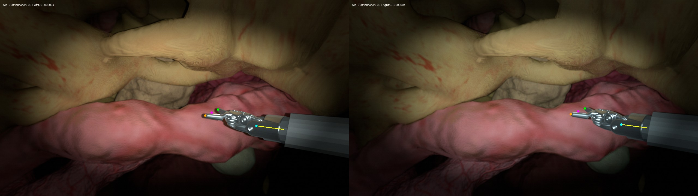
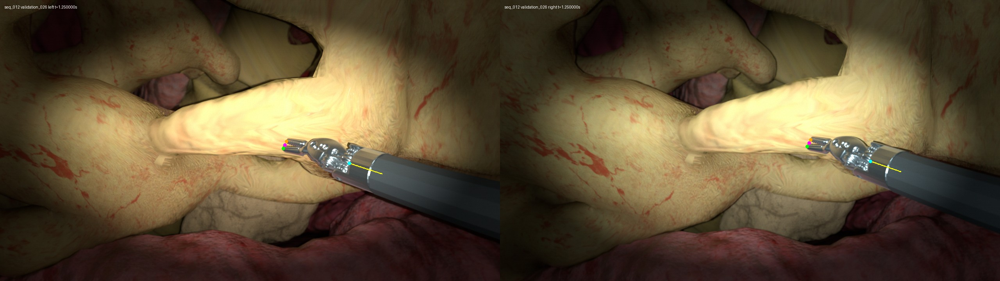
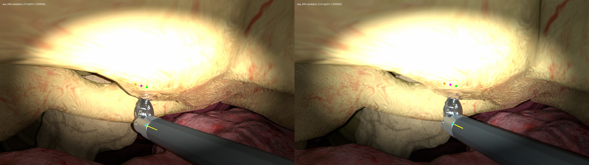
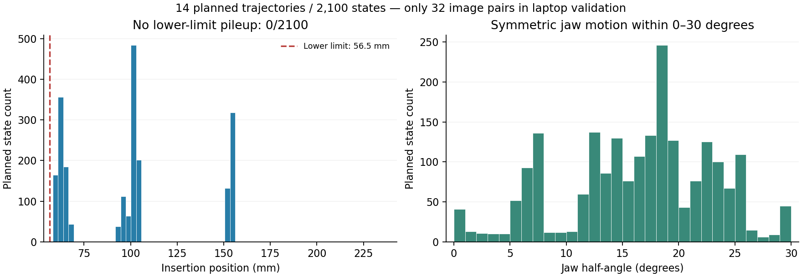

# Completed laptop validation

The checked implementation's source digest is recorded in `environment_and_readback.json`. Execution uses the portable asset bundle and Isaac Sim 5.1.0 on an RTX 4060 Laptop GPU with 8 GB memory.

## Completed geometry and portability checks

- `unit_tests.json`: 20 passing tests, including missing anatomy/references, surface penetration, fully contained geometry, invalid joint limits, unsafe motion between frames, preserved geometric contact/sliding, corrupt records, and the cumulative laptop render cap. These tests render no images.
- `trajectory_coverage.json`: all 14 complete trajectories passed, covering 2,100 planned frame states and 9,220 total checked states after interval subdivision. There are 490 frame states in the geometric-contact band. Failed candidates were replanned before acceptance; no intermediate frames were removed.
- `portable_runtime_check.json`: portable asset export preserved all checked PSM/ECM joint values and transforms exactly. MP4 encoding/decoding preserved a four-frame 60 fps test stream.
- `environment_and_readback.json`: source and run fingerprints, software versions, dependency audit and independent USD/FK readback checks. The portable dependency audit found no unresolved active assets or absolute authored asset paths.

The earlier implementation and samples were independently checked against their 98 recorded hashes and remained unchanged.

## Render and label acceptance

The bounded run completed **32/32 stereo pairs** and [automated acceptance passed](report.json). There were exactly 32 render attempts, no failed captures, and no full dataset generation. Final status is `validated`, `validation_complete: true`, `dataset_complete: false`. Isaac Sim exited after validation.

| Check | Observed result |
|---|---|
| Capture selection | Seven four-frame consecutive clips plus closed, maximum-open, contact and withdrawal keyframes |
| Image dimensions | 1280 × 720 per eye; raw PNGs and visible masks |
| Nominal sampling | 60 Hz; adjacent selected frames separated by 1/60 second |
| Independent distorted projection arithmetic | Maximum error 1.1368683772161603e-13 px, below 1e-6 px |
| Left/right coordinate consistency | Maximum position discrepancy 3.9085729160208465e-13 mm |
| Directly visible physical endpoints | Two observations checked; maximum distance to visible mask 0.5125986302470663 px |
| Pose updates reach the renderer | Masks change in all seven clips; opening the jaws changes 1,669 left and 1,671 right pixels |
| Actual contact/sliding examples | Gap 0.0498646662 mm in contact keyframe; 0.0502427835 mm in first combined sliding frame |
| Insertion coverage | 0.0582111387–0.1561735823 m across 2,100 planned states; zero states within 1 µm of the lower stop |
| Sequence split | 10 train / 2 validation / 2 test; no within-sequence splitting |

The [rendered-data audit](dataset_audit.json) checks all 32 pairs. The relative camera transform remains fixed within each sequence to numerical precision: maximum translation-element change 2.2737367544323206e-13 mm. Rendered baseline examples are 5.5300843135 mm for the base rig and 5.3839790213 mm for the perturbed rig. These are scene truth, not estimates passed into a model.

Across the 128 physical endpoint observations (32 pairs × two eyes × two endpoints), two are directly visible, 110 are self-occluded and 16 are tissue-occluded. A visible jaw region does not imply that its selected fixed surface endpoint is visible. The limited directly visible-point coverage is reported explicitly rather than claiming 128 visible alignment checks.

The two jaw-limit keyframes are isolated validation poses, not adjacent temporal training frames. The other clips use consecutive frame indices with a 1/60-second interval. RGB training images contain no overlaid labels; annotated previews are separate files.

The numerical projection tolerance measures agreement of coordinate/projection implementations. It does not measure learned image-based pose accuracy or physical camera calibration accuracy. Surface contact is an undeformed, near-zero-gap geometric approximation and does not claim force validation.

## Resume and fault handling

[Actual completed-run resume](resume_check.json) exited successfully with **zero new render attempts**. All 224 original data-file checksums and the trajectory index remained unchanged. The local review copy was checked against the same hashes.

[Fault injection on copies of actual records](record_fault_checks.json) rejected a corrupt PNG, a missing right mask and an interrupted record without its commit receipt. Only the affected pair became pending; valid pairs remained complete. These copied-record interruption tests and the actual completed-run resume do not claim a forced GPU-process crash during rendering was tested.

The 20 geometry/integrity tests also reject missing anatomy, unresolved assets, penetration, fully contained geometry, joint violations, between-frame crossing, changed caches and attempts to exceed the cumulative laptop render cap. Positive contact and sliding cases pass.

## Actual parameters and provenance

- [Run manifest and asset hashes](run_manifest.json), [environment](environment_and_readback.json), [portable bundle checks](portable_runtime_check.json).
- [Source camera calibration](camera_source.json) and [effective camera calibration](camera_effective.json).
- [Source appearance profile](appearance_source.json), [effective settings](effective_settings.json), [render mapping](render_map.json) and [native camera readback](native_camera_readback.json).
- [Actual joints](joints.json), [complete trajectory coverage](trajectory_coverage.json), [render inventory](render_inventory.json) and [execution timings](render_execution.json).

The retained settings include PathTracing at 64 samples/frame × four subframes, minimum linear vignette gain 0.035, global linear brightness multiplier 0.75, and the recorded K/D. Camera readback confirms focal length 4 mm, f/5.6 and focus distance 100 mm within floating-point precision. Optical mount and these optical starting values retain their documented simulation-design status; they are not relabeled as measured official dVRK calibration. See the [implementation documentation and original sources](../README.md#sources).

The 60 Hz timestamps describe simulation sampling. Offline path tracing took approximately 228–287 seconds per pair on this laptop; this is not real-time rendering. No shutter integration or motion blur is claimed.

## Visual review

The seven category views and four key states were inspected. [Appearance diagnostics](appearance_review.json) preserve measurements from all 64 raw images. The occlusion close-up has strong tissue highlight saturation: 7.37% of left and 7.69% of right pixels have all three channels at least 250. This diagnostic is not a clinical acceptance threshold. The approved imaging settings were retained; quantitative matching to real camera photometry has not been established.

Previews draw ground-truth projections even when a point is occluded. Cyan is C, yellow is the shaft-axis segment, magenta is virtual midpoint T, and green/orange are physical jaw endpoints. C and T are not treated as visible surface landmarks.

Maximum allowed jaw opening:

Contact/sliding with preserved tissue shape:

Tissue occlusion, including the documented near-field saturation:

The insertion distribution has no lower-stop pile-up; it is conditioned on the planned motion states, not asserted to be uniform over the entire joint range.

