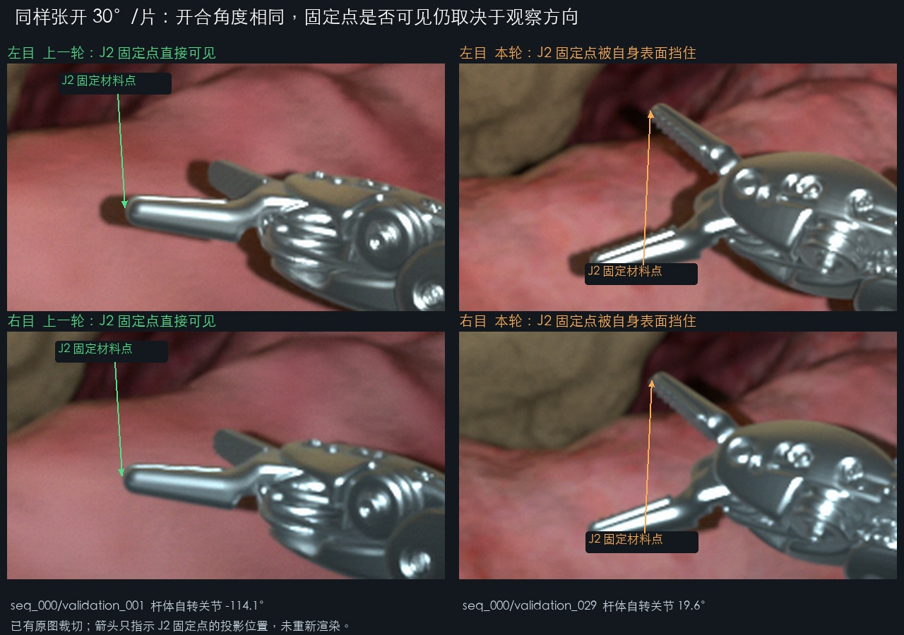

# 固定尖端 0/128 的原因核查

核查日期：2026-11-09。对象为 `balanced_2100_20261108_acceptance` 的全部 32 对已有图片、掩码、相机/部件真值及原始 USD 网格。**未启动 SimulationApp，未重新渲染，原始 224 个样本文件和源场景未改变。**

结论：固定三维点的位置没有取错到腕部或漂移，未发现改变这 128 次分类结果的遮挡误判。统计结果由固定表面点定义和观察方向共同决定。**自遮挡和组织遮挡就是用户要求的数据状态，不是质量缺陷或删图理由；不新增固定尖端必须直接可见的要求。** 尖端区域可见不等于其中一个固定表面点直接可见，二者继续分别记录。

本报告先前把“固定点直接可见为零”解释为必须修复的规划/验收遗漏，该判断超出了用户要求，现已撤回。下面保留实际测量结果和代码行为说明；无需因这些遮挡统计重规划、重渲染或改写真值。

## 1. 每次观测到底被什么遮挡

128 次＝32 对×左右两目×两片钳口，全部固定点均在画幅内。

| 独立几何核查结果 | 次数 |
|---|---:|
| 被同一片钳口的近侧表面遮挡 | 118 |
| 被另一片钳口遮挡 | 6 |
| 被小肠组织遮挡 | 4 |
| 固定点直接可见 | 0 |

独立 NumPy 双面射线—三角形求交使用 9 个真实器械视觉网格和 17 个器官网格，不调用生产代码的 `Safety.visible()`、`classify_rays()` 或 trimesh 射线函数。128 次分类及遮挡物名称与保存标签全部一致；另外通过 5 个合成射线检查和上一轮两个已知可见观测的复核。

器械遮挡时，前方金属表面比目标点更靠近相机 **0.265499～1.402406 mm**，大于现有 0.05 mm 的端点容差。把排除容差分别改为 0.0001、0.01、0.05、0.1、0.2 mm，仅用于离线敏感性核查，直接可见数仍全部为 0；生产参数没有修改。

124 次器械遮挡观测中，122 次投影取整像素落在可见器械掩码中；另外 2 次位于轮廓边缘，连续投影距最近掩码像素分别为 0.709、1.040 像素。4 次组织遮挡投影不在器械掩码中。掩码中的像素看到近侧金属表面，不能证明背面的固定点可见。32 对中，末端 1 mm 区域为 124/128 次可见。两次轮廓边缘记录见 [mask_edge_cases.json](mask_edge_cases.json)。

## 2. 尖端定义是否错误

`kinematics.py::physical_landmarks()` 从每片钳口网格最大局部 Y 的顶点集合取中心，再投到真实曲面上，之后固定在部件坐标系中。这是**根据官方网格制定的项目标签定义，不是厂商提供的人工关键点标注**，也不是每帧重新挑选的图像轮廓最前点。

| 点 | 钳口部件坐标系中的固定位置（mm） |
|---|---|
| J1 | (0.285654619, 9.650346052, −0.010669412) |
| J2 | (−0.285654619, 9.650346052, −0.014330588) |

两点到真实曲面的距离小于 2.3×10⁻¹³ mm，距末端最大 Y 仅约 0.001654 mm；保存真值逆变换后的局部点与源定义最大差 1.70×10⁻⁶ mm。两点都在末端曲面上，不是悬空点或明显陷在模型内部。但这 128 次观察中，包含该点的末端面均背向相机，近侧面挡住了该固定点。

## 3. 为什么上一次有 2 次，这次变成 0

上一轮 `seq_000/validation_001` 的两次可见观测均为 J2，左右目各一次。旧版 `planner.py::jaw_keyframes()` 会额外搜索可见尖端的独立验证姿态，该样例杆体自转约 −114.1°；本轮实际轨迹中的最大开口样例为约 +19.6°，腕部姿态也不同。两者虽然每片都张开 30°，末端面的朝向却不同。独立求交重现了旧图的两次直接可见，不存在判定器“一律返回不可见”的问题。

本轮改成从真实连续轨迹取验证帧，没有再使用旧的独立验证姿态，因此与旧样本的可见性统计不同。当前代码行为是：

- `planner.py::sample_free()` 在基础姿态附近取样，`contact_path()` 的目标姿态也围绕同一基础方向；入画、投影长度和无穿透检查不会保证固定点直接可见。
- `dataset_policy.py::diagnostic_jobs()` 选择运动明显和开合/接触关键帧，但不要求有固定点直接可见样本。
- `verify.py` 中 `if not tip_distances and not balanced` 将旧版固定点正样本检查限定在旧模式；当前平衡模式允许固定点均被遮挡，并通过可见末端区域核对掩码。该行为符合保留遮挡样本的要求。
- 训练覆盖验证要求训练含有验证/测试已出现的状态；它不额外规定必须存在固定点直接可见样本，也不以单帧被遮挡为理由删除数据。

这些行为无需增加直接可见门槛。几何、连续性、关节限位和原定训练/验证/测试分布检查仍按已确认方案执行。不能用固定点可见性统计单独判断数据集是否合格。

## 4. 全部已规划状态的统计

直接读取现有全部 2,100 个规划状态：8,400 次固定点观测中，原规划标签为 7,634 次器械遮挡、766 次组织遮挡、0 次直接可见。另用真实末端面法向和每帧相机/部件变换复核，8,400 次也全部为背向相机。该扩展核查只检查已有轨迹几何，不代表全量图片已经生成或验证。

现有图片通常能清楚看到钳口末端区域，固定端面点的三维真值在被遮挡时仍然存在，并继续保存供监督和评估使用。没有直接可见样本是这套既定路径的统计事实，不是新增的生成阻碍，也不影响保留遮挡图像及其真值。

继续按已确认的 2,100 对方案生成，保留 J1/J2 的固定身份及真实遮挡标签；不逐帧替换成朝向相机的另一个表面点，不把区域可见改写为固定点可见。本次诊断及文档纠正没有改变生产路径、标签定义或验收逻辑。

## 5. 证据文件

- [逐观测求交结果](observations.json)：距离、遮挡物、末端面方向、掩码支持、容差敏感性。
- [固定点及局部面定义](point_definitions.json)。原模型有退化三角形；最近点核查明确排除非有限计算值，未把它们计为有效表面。
- [上轮可见正样本复核](previous_visible_reference.json)。
- [全部规划状态的末端面朝向](planned_surface_orientations.json)、[已保存规划可见性统计](planned_saved_visibility.json)。
- [左目 32 张局部检查图](all_32_tip_crops.jpg)、[右目 32 张局部检查图](all_32_right_tip_crops.jpg)。红点为 J1，蓝点为 J2，均为固定点投影；图片只做裁切和标示，未调整曝光。
- [机器可读汇总](summary.json)。

复核入口为 `tools/audit_fixed_tip_visibility.py`，输出必须放在原运行目录之外。它不修改生成器、源资产、原图或标签。
