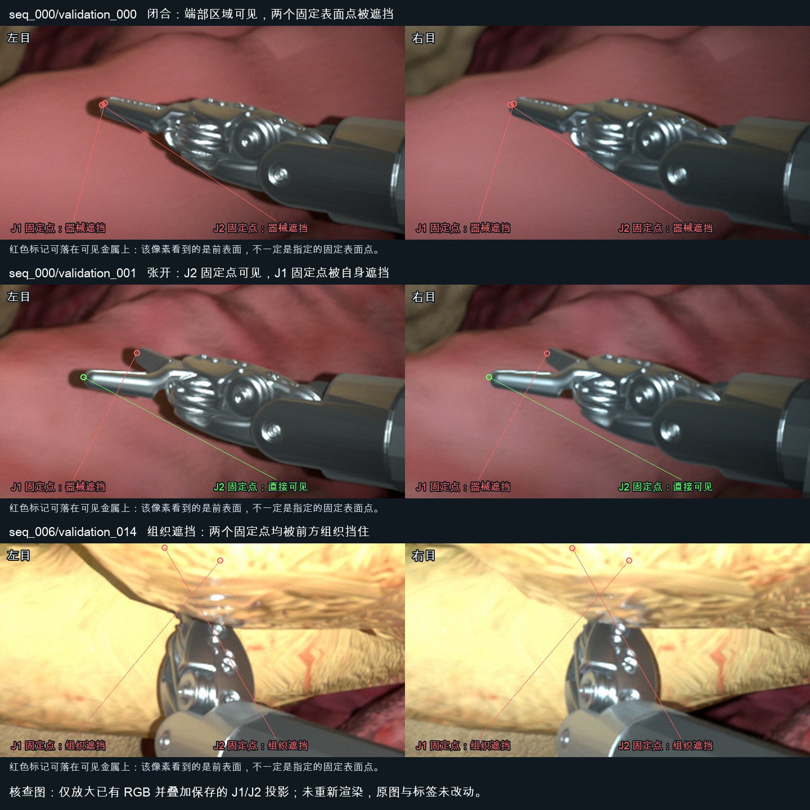

# Fixed-tip visibility and lighting audit

This audit used all 32 existing RGB pairs, masks, saved body/camera transforms and the versioned USD meshes. No new image was rendered, and all original pair integrity checks passed. Production tip definitions, visibility code, camera poses and lighting settings were not changed.

The 128 observations mean 32 pairs × 2 eyes × 2 fixed CAD surface points. They do not count whether the jaw-tip region is visually discernible.

| Fixed-point classification | Count | Independent finding |
|---|---:|---|
| Directly visible | 2 | Jaw 2 in the maximum-opening pair, one observation per eye |
| Instrument occlusion | 110 | 108 blocked by the same jaw's front surface; 2 by the other jaw |
| Tissue occlusion | 16 | All four saved frames of seq_006, both eyes and both jaws |

An independent NumPy ray–triangle intersection calculation on the saved visual meshes reproduced every instrument-occlusion decision. The surface in front of each instrument-hidden fixed point was 0.4116–1.5525 mm closer to the camera, well above the existing 0.05 mm endpoint exclusion tolerance. All 110 projected pixels also lie inside the visible instrument mask: the pixel sees metal, but it sees another surface point. Independent ray tests on the 17 actual anatomical meshes reproduced all 16 tissue occlusions and found no additional tissue occlusions among these observations.

The selected points lie on the actual distal jaw surfaces, approximately 0.00165 mm behind the maximum local Y extent. Their body-local locations stay constant to about 6.2e-13 mm across the saved states. They are not misplaced at the wrist or drifting between frames. However, the chosen distal-cap material points face away from the cameras in 126 observations; the existing poses largely view the same side of the tool. Thus the point definition and viewpoint distribution produce a very low fixed-point visibility count. This is not evidence that 126 images lack visible jaw-tip regions, and it is not a reason to mark real self-occlusion as visible.

Future coverage accounting should distinguish fixed-point visibility, visibility of a defined distal region, tissue occlusion and out-of-frame state. Fixed physical landmarks should retain identity across views. Additional views may be needed for directly observing those landmarks, but this audit does not change any labels or trajectories.

The visibly overbright images are `seq_006/validation_014` through `validation_017`. Their category is occlusion, light/noise/blur multipliers are all 1.0, native light intensity is 1,000,000 in the existing simulator setting, and light exposure is 0. This is not a deliberately increased-intensity example. The obstructing tissue lies approximately 54–57 mm along the first pair's endpoint rays, compared with approximately 99–102 mm to the endpoints. Near-field illumination and material reflection are consistent with the saturated foreground appearance; their exact photometric contributions have not been isolated by a lighting intervention.

In the first pair, 7.3679% of left and 7.6860% of right raw-image pixels have all RGB channels at least 250. Across the four pairs the range is 7.3420–7.7067%; all other saved sequence groups are below 0.083%. The separate lighting-category samples have actual multipliers approximately 0.785–0.934 and do not show this large clipped patch. Treat seq_006 as an overexposed occlusion sample, not as the normal exposure target. No exposure correction is applied by this audit.

The marked points are diagnostic image projections, not estimated pose or a replacement for the approved XYZ overlays. Numerical results are in `summary.json` and `image_statistics.json`.
