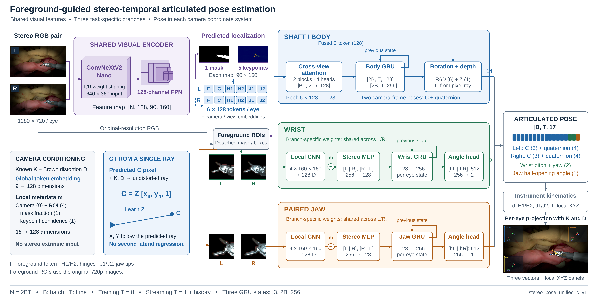

# StereoSurgicalPose

Foreground-guided stereo temporal estimation of an articulated surgical instrument, with camera-frame pose outputs, fixed instrument kinematics and real-time projection overlays.

This repository contains the simulator pipeline, model, training/evaluation tools, three architecture diagrams and inference optimization records.

## Start here

- [Project route and reproducibility scope](docs/PROJECT_ROUTE.md)
- [Model, tensor dimensions and three branches](StereoPoseLearning/docs/MODEL_DIAGRAMS.md)
- [Architecture exploration: design rationale and evaluation methods](StereoPoseLearning/docs/ARCHITECTURE_EXPLORATION.md)
- [Environment, data and inference interfaces](StereoPoseLearning/docs/REPRODUCING.md)
- [Dataset split contract](docs/DATA_PROTOCOL.md)
- [Performance statistics and optimization process](StereoPoseLearning/docs/PERFORMANCE_INDEX.md)
- [Simulation and parameter sources](CameraImagingConfig/README.md)
- [Release contents and Git history scope](docs/PUBLIC_RELEASE.md)

## Components

| Directory | Purpose |
|---|---|
| `CameraImagingConfig` | Recorded camera parameters; continuous stereo generation, geometry checks and labels |
| `StereoPoseLearning/stereo_pose` | Network, dataset reader, losses, training and inference |
| `StereoPoseLearning/assets` | Fixed instrument dimensions and kinematic chain |
| `StereoPoseLearning/reference/pose_display` | Independent decoding, camera projection and C++ overlays |
| `StereoPoseLearning/native/libtorch` | C++ model execution, GPU preprocessing, TensorRT and CUDA fusions |

Inputs are synchronized left/right RGB and each camera's K/D. Outputs are C and a shaft quaternion for each camera, plus shared wrist pitch/yaw and jaw half-opening: 17 values. The network does not require the left-to-right extrinsic transform or baseline as an input.

## Dataset inventory

The generated dataset contains **2,520 stereo pairs / 5,040 RGB images / 23 trajectories**, sampled at **60 Hz** and **1280×720 per eye**. It consists of the base 2,100 pairs plus 420 pairs from two additional training trajectories. The original whole-trajectory assignments are:

| Split | Stereo pairs | Trajectories |
|---|---:|---:|
| Training | 1,820 | 9 |
| Validation | 350 | 7 |
| Test | 350 | 7 |
| Total | 2,520 | 23 |

The seven categories cover position and orientation, lighting, imaging quality, occlusion, ECM motion, stereo geometry and combined variation. See the [dataset description](docs/DATA_PROTOCOL.md) for the per-category counts and data fields.

## Inference performance

Historical RTX 4060 Laptop measurements report approximately **12.98 ms per stereo pair / 77.04 Hz**, from in-memory RGB through preprocessing, inference, kinematics and drawing. Camera capture, decoding, video encoding and display refresh are excluded. These are execution measurements on a fixed internal checkpoint, not pose-accuracy or generalization results. See the benchmark records for hardware, precision and timing scope.

