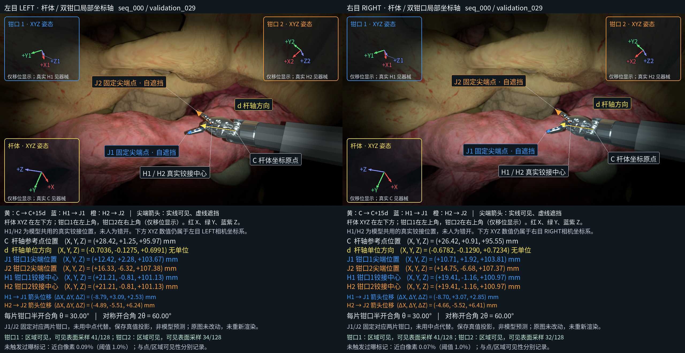

# StereoSurgicalPose

Stereo vision for surgical instrument localization and pose estimation, with reproducible camera configurations and simulation experiment records.

## Current generator — 2026-11-09

The current scene contains **one active surgical instrument** (`PSM_Right`), organs, the ECM and two cameras. `PSM_Left` is explicitly inactive. Its name can still appear in the referenced source asset; it is not a second active instrument in this capture.

The current entry point is [TemporalStereo_v2](CameraImagingConfig/src/TemporalStereo_v2/README.md). It generates **2,100 synchronized stereo pairs** from 21 independent temporal trajectories, at **1280 × 720 per eye** and **60 Hz sampling timestamps**. PathTracing rendering speed is separate from the sampling rate.

| Split | Stereo pairs |
|---|---:|
| Training | 1,400 |
| Validation | 350 |
| Test | 350 |

Self-occlusion and tissue occlusion are intended dataset states. Their images, complete 3D truth and visibility labels are retained. A fixed endpoint does **not** have to be directly visible; the 0/128 direct-visibility count in the bounded run is a recorded observation, not a reason to discard data or change the planned paths.

The laptop validation checked all 21 paths and rendered 32 diagnostic pairs. Calculation checks covered all 2,100 planned states. Full dataset generation and target-server GPU validation have not been started.

[Dataset configuration](CameraImagingConfig/src/TemporalStereo_v2/DATASET_SPLITS.md) · [Server migration and commands](CameraImagingConfig/src/TemporalStereo_v2/SERVER_MIGRATION.md) · [Validation evidence](CameraImagingConfig/src/TemporalStereo_v2/validation_evidence/balanced_2100/README.md)

## Modules

| Directory | Contents |
|---|---|
| `CameraImagingConfig/` | Current temporal generator, portable deployment, camera configuration and sources; earlier captures retained |
| `StereoCalibration/` | Historical endpoint and relative-pose diagnostics, with recorded failures |
| `SurgicalPoseEstimation/` | Pose-interface navigation and historical static examples |

Each new pair saves RGB, masks, C/d/H1/H2/J1/J2/T, full part frames, joints, timestamps and visibility/contact labels. The [model interface](CameraImagingConfig/src/TemporalStereo_v2/MODEL_INPUT_OUTPUT.md) describes 17 proposed prediction values and the fixed instrument geometry used to decode them. [Shared calculation and display code](CameraImagingConfig/src/TemporalStereo_v2/pose_display/README.md) supplies the approved arrows/XYZ overlays and video callback. No trained pose estimator is included. Relative camera transforms and baseline remain separate evaluation truth, not mandatory model inputs.

The portable generator uses machine configuration files. Large USD/texture assets, render caches, recordings and model weights remain outside Git and are supplied separately in the transfer bundle. The [historical source inventory](docs/source_snapshot.json) preserves the earlier 2026-11-07 snapshots; `python3 scripts/verify_snapshot.py` checks their hashes and repository syntax without launching Isaac Sim.

## Confirmed imaging baseline

Accepted on **2026-11-07**:

- Minimum vignette gain: **3.5%** in linear RGB.
- Global brightness multiplier: **0.75** (25% reduction in linear RGB).
- At 720p, ellipse center: **(639.5, 359.5) px**; semiaxes: **(560, 313.333333) px**.
- Smoothstep transition: **0.30–1.10** in normalized elliptical radius.
- Original appearance-reference resolution: **1920 × 1080 per eye**; the current generator preserves the normalized ellipse at 720p.

[Parameter record](CameraImagingConfig/docs/IMAGING_BASELINE.md) · [Machine-readable baseline](CameraImagingConfig/config/confirmed_baseline.json) · [Sources](CameraImagingConfig/docs/SOURCES.md)

Intrinsics and distortion use the documented DRENDS reference profile and the recorded resize convention. Visual acceptance is recorded; a calibrated photometric match to the target physical camera has not been established.

The [three earlier static stereo examples](SurgicalPoseEstimation/examples/shaft_tip_stereo/details.jpg) remain unchanged at 1920 × 1080. Their C/d/T labels and [historical runtime notes](docs/RUNNING.md#historical-2026-11-07-snapshot) describe that older capture, not the current generator.
