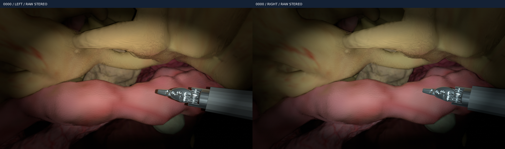

# StereoSurgicalPose

Stereo vision for surgical instrument localization and pose estimation, with reproducible camera configurations and simulation experiment records.

## Current snapshot — 2026-11-07

The current scene contains **one active surgical instrument** (`PSM_Right`), organs, the ECM and two cameras. `PSM_Left` is explicitly inactive. Its name can still appear in the referenced source asset; it is not a second active instrument in this capture.

Three synchronized stereo pairs were rendered with Isaac Sim 5.1 PathTracing at **1920 × 1080 per eye**. Each pair includes shaft reference **C**, shaft unit direction **d**, and closed-jaw tip **T**, expressed independently in the left and right optical frames: **9 numbers per eye, 18 per pair**.

[Annotated examples](SurgicalPoseEstimation/examples/shaft_tip_stereo/details.jpg) · [Label definitions](SurgicalPoseEstimation/README.md) · [Runtime notes](docs/RUNNING.md)

## Modules

| Directory | Contents |
|---|---|
| `CameraImagingConfig/` | Tested single-instrument capture scripts, scene overlays, imaging parameters and sources |
| `StereoCalibration/` | Historical endpoint and relative-pose diagnostics, with recorded failures |
| `SurgicalPoseEstimation/` | Three stereo examples, per-camera labels and projection checks |

The source snapshot preserves the tested Ubuntu scripts and their original paths. Large external assets, render caches, recordings and model weights remain outside Git. [SHA-256 provenance](docs/source_snapshot.json) records the copied files. Run `python3 scripts/verify_snapshot.py` to check the backup without Isaac Sim.

The implemented capture uses three static instrument placements with fixed camera geometry. Configurable 720p capture, randomized bulk generation and multiple camera-rig configurations are not implemented in this snapshot. No learned pose estimator is included. Historical stereo calibration is not a prerequisite for generating or projecting the current per-camera truth labels.

## Confirmed imaging baseline

Accepted on **2026-11-07**:

- Minimum vignette gain: **3.5%** in linear RGB.
- Global brightness multiplier: **0.75** (25% reduction in linear RGB).
- Ellipse center: **(959.5, 539.5) px**; semiaxes: **(840, 470) px**.
- Smoothstep transition: **0.30–1.10** in normalized elliptical radius.
- Preview resolution: **1920 × 1080 per eye**.

[Parameter record](CameraImagingConfig/docs/IMAGING_BASELINE.md) · [Machine-readable baseline](CameraImagingConfig/config/confirmed_baseline.json) · [Sources](CameraImagingConfig/docs/SOURCES.md)

The current single-instrument preview retains these approved appearance settings. Intrinsics and distortion use the documented DRENDS reference profile. Visual acceptance is recorded; a calibrated match to the target physical camera has not been established.
