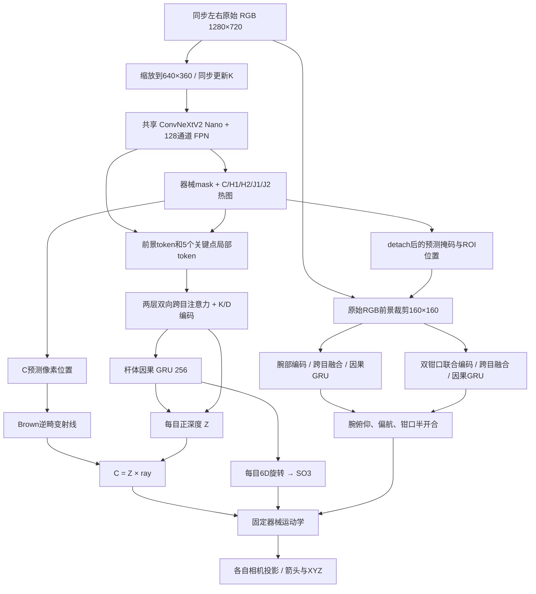

# 当前模型结构与数据契约

当前版本：`stereo_pose_unified_c_v1`。实际可执行参数以运行目录的 `config.json` 和 checkpoint 内嵌配置为准；仓库 `configs/default.json` 是新训练模板。

[论文式框架图、两张详细结构图和模块尺寸说明](MODEL_DIAGRAMS.md) · [性能记录](PERFORMANCE_INDEX.md)

## 1. 网络数据流



## 2. 特征与分支配置

| 模块 | 当前实现 |
|---|---|
| 主干 | `convnextv2_nano.fcmae_ft_in22k_in1k`，加载预训练主干后与任务层联合训练 |
| FPN | 128 通道，预测器械二值 mask 和 5 个关键点热图 |
| 引导 token | 1 个前景 token + C/H1/H2/J1/J2 共 5 个局部 token；8×8 采样、4×4 池化、轻量局部编码 |
| 双目融合 | 2 层双向 cross-attention，4 个头；每目 K/D 编码和视图标识 |
| 杆体时序 | 256 维因果 GRU；每目单独状态 |
| C 分支 | 热图预测 `(u,v)` 是唯一横向定位来源；学习正光学深度 Z |
| 旋转分支 | 每目 6D 旋转参数经正交化得到 R；导出为 xyzw 四元数 |
| 局部图像 | 原始 RGB 上应用预测前景，再裁剪到 160×160；额外 mask 通道，阈值 0.2、膨胀 1 个原图像素 |
| 腕部分支 | 轻量 4→32→48→64 通道编码、4×4 描述、双目融合、独立 GRU 和 2 角度头 |
| 钳口分支 | 两片钳口与铰链的联合 ROI，同样的轻量编码及独立 GRU，输出半开合角 |
| 路由 | ROI 位置和掩码在进入角度分支前 detach；角度头没有全局 FPN 特征旁路 |

全局定位仍读取完整图像，因此不能宣称整个网络完全与背景无关。局部分支限制的是角度预测的特征路径；其预测 ROI 仍依赖上游定位质量。二值器械掩码不等于两片钳口的独立语义标签。

## 3. C 的唯一定位定义

设 `u_C` 为当前相机 C 热图解码的像素，`K,D` 对应同一输入尺寸：

```text
(xn,yn) = undistort_brown(u_C, K, D)
C = Z × [xn, yn, 1]
```

Z 是光学轴方向深度，不是到相机的欧氏距离。旧的另一套 X/Y 回归已移除。没有额外残差回归、推理后修正或专为“拉回热图”新增的约束损失。现有位置、深度和投影损失仍用于训练。

这会使 C 三维投影与 C 热图一致，但不会保证热图预测正确或 Z 正确。当前热图只能表达输入图像范围内的位置；C 长时间出画时需要重新设计定位表示，不能把当前位置的数值测试当作出画能力证明。

## 4. 输出字段与固定几何

| 17值索引（从0开始） | 字段 | 单位/含义 |
|---|---|---|
| 0–2 | C_L | 左相机中的杆体参考点，mm |
| 3–6 | quat_L | 杆体局部坐标到左相机的旋转，xyzw |
| 7–9 | C_R | 右相机中的杆体参考点，mm |
| 10–13 | quat_R | 杆体局部坐标到右相机的旋转，xyzw |
| 14 | wrist_pitch | 固定 CAD 关节定义下的腕部俯仰，rad |
| 15 | wrist_yaw | 固定 CAD 关节定义下的腕部偏航，rad |
| 16 | jaw_half | 对称钳口半开合，rad；总开合为两倍 |

完整杆体旋转保留自转信息，只有 d 不够。当前两片钳口对称联动，实际 gripper1/gripper2 关节分别使用 `-jaw_half`、`+jaw_half`；不支持两片钳口独立自由开合。

`assets/instrument_model.json` 提供模型实际的轴向、绑定变换、转轴和尖端局部坐标。逐关节链为：

```text
T_parent_child(q) = A × Rot(axis, q - q_bind) × inverse(A) × B
T_camera_child = T_camera_parent × T_parent_child(q)
```

将模型表面定义的两个尖端点变换到相机坐标得到 J1/J2；铰链中心按其真实 joint frame 求 H1/H2；`T=(J1+J2)/2`；`d=R[:,2]`。C 是固定杆体参考点，T 是虚拟中点，不能伪造为可见表面点。

左右分别使用 `π(K_L,D_L,point_L)` 和 `π(K_R,D_R,point_R)` 投影。杆轴箭头从 C 沿 d；钳口箭头分别从 H1/H2 指向 J1/J2；三组自身 XYZ 姿态放在已确认的分离显示区域。没有独立可见性预测时显示 `unknown`，不会偷用真值遮挡状态。

## 5. 监督目标与几何约束

位置尺度 10 mm，投影尺度 20 个网络输入像素，三个角度尺度为 10°/10°/5°。当前各项权重：

| 项 | 权重 | 监督对象 |
|---|---:|---|
| position / rotation | 1 / 1 | C 与完整杆体旋转 |
| joints | 0.1 | 腕 pitch、yaw、jaw_half |
| geometry / part_rotation | 1 / 0.25 | 运动学关键点与部件姿态 |
| projection / depth | 0.2 / 0.1 | 二维投影与深度 |
| mask / heatmap | 0.1 / 1 | 器械分割与全局关键点热图 |
| local_heatmap / landmark_uv | 1 / 1 | 局部关键点和直接像素监督 |
| landmark_consistency | 0 | 关闭早期预测热图一致性项 |

`decouple_geometry=true`：关节专用几何监督使用真值杆体位姿作为锚；杆体专用监督使用真值关节角作为锚，减少两类预测互相补偿。真值只进入 loss，不进入推理模型。详见 `losses.py` 与 `test_part_losses.py`。
