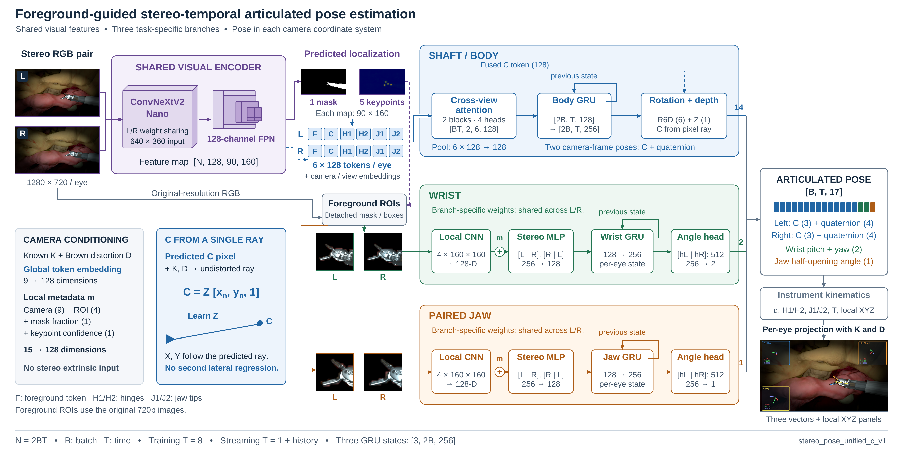
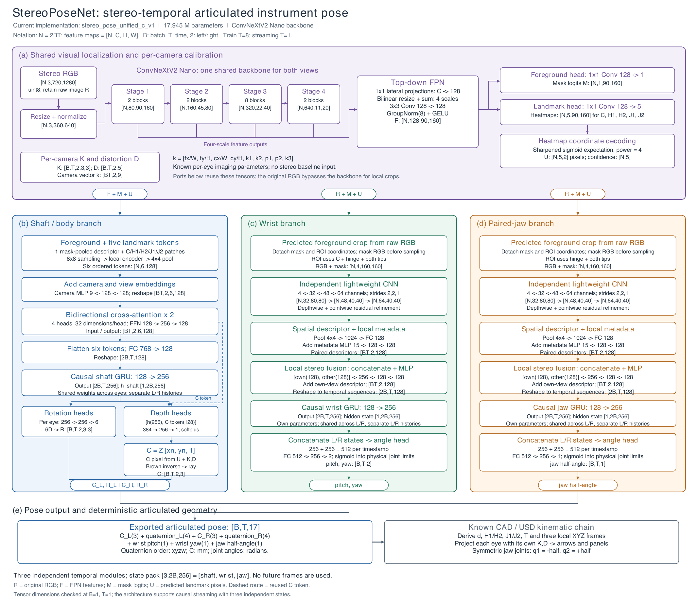
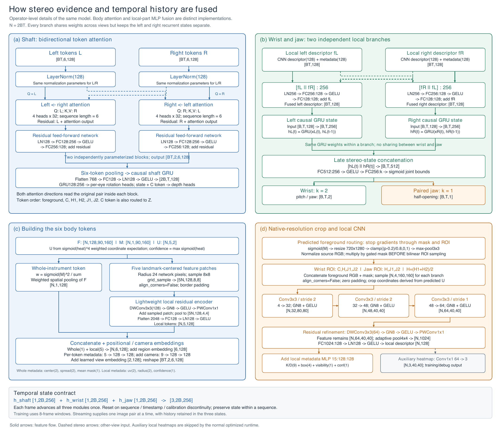

# 当前模型：框架图、详细结构与模块说明

对应实现为 `stereo_pose_unified_c_v1`。图中结构来自实际代码和固定权重的 CPU 前向尺寸核查，总参数 **17,945,453**，其中 ConvNeXtV2 Nano 主干 **14,981,520**。这里描述当前模型，不把历史探索阶段的网络混入当前结构。

## 三张图

### 1. 论文式框架图

[可编辑 SVG](figures/model/framework.svg) · [矢量 PDF](figures/model/framework.pdf)

紫色是共享视觉定位，蓝色是杆体，绿色是腕部，橙色是双钳口联合分支。实线表示主要数据流，虚线表示特征/定位复用。图中的 mask、关键点图、局部裁剪和投影示例都来自现有图像上的模型预测；不是新渲染，也不是把真值画成预测。框架图中的局部元数据 `m` 是相机参数、ROI、预测 mask 比例和关键点置信度，共 15 维。

字体、模块基线、尺寸标注和连线已重新排版。PDF/SVG 嵌入 Liberation Sans 常规和粗体字体，避免打开时字体替换；PNG 用于 GitHub 直接预览。

### 2. 网络与张量尺寸总图

[原始 SVG](figures/model/network_overview.svg)。这张图保持此前版本不变，按感知、杆体、腕部、钳口及几何输出列出各层输入输出。

### 3. 双目、时序与局部算子展开图

[原始 SVG](figures/model/fusion_and_operator_details.svg) · [两张详细图的合并 PDF](figures/model/detailed_structure.pdf)

这张图同样原样保留。图中文字 `visibility` 指**预测前景 mask 在 ROI 中的观测比例**，不是组织遮挡真值，也不是预测“尖端是否直接可见”的标签。局部 CNN 展开是结构模板，腕部与钳口各有独立参数，并非共用同一份局部权重。

## 尺寸约定

- `B`：批量；`T`：连续时间步；`N = 2BT`：将左右目和时间展平后的图像数。
- 特征张量按 `[N, C, H, W]`；图像分辨率通常写成 `W × H`。
- 原图每目 1280×720；主干每目 640×360；腕部、钳口 ROI 各为 160×160。
- 训练窗口 `T=8`；实时推理 `T=1`，保留过去帧的三个 GRU 状态。不是每次重新推理八张历史图片。
- 输入为左右 RGB、各自的 K/D 和历史状态。网络不接收 baseline、左右外参、真值关节角或真值分割。

## 共享视觉定位

| 模块 | 输入 → 输出 | 作用及实现 |
|---|---|---|
| 预处理 | 原图 `[B,T,2,3,720,1280]` → `[B,T,2,3,360,640]` | 缩放、RGB 归一化；K 与缩放后的像素坐标对应。原始 uint8 RGB 保留给局部分支 |
| ConvNeXtV2 Nano | `[N,3,360,640]` → 四个尺度 | 左右目共享权重；以预训练权重初始化后，与任务模块联合训练 |
| Stage 1 | `[N,80,90,160]` | 2 个 ConvNeXtV2 block |
| Stage 2 | `[N,160,45,80]` | 2 个 block |
| Stage 3 | `[N,320,22,40]` | 8 个 block；实际高度是 22，不是按理想整除误写成 23 |
| Stage 4 | `[N,640,11,20]` | 2 个 block |
| FPN | 四个尺度 → `[N,128,90,160]` | 各尺度 1×1 投影，按实际尺寸双线性上采样相加；最终 3×3 Conv、GroupNorm(8)、GELU |
| mask 头 | `[N,128,90,160]` → `[N,1,90,160]` | 整件器械的二值前景 logits，不是上下钳口独立分割 |
| 关键点头 | `[N,128,90,160]` → `[N,5,90,160]` | 通道顺序 C、H1、H2、J1、J2 |
| 关键点解码 | 5 张热图 → `[N,5,2]` 与 `[N,5]` | sigmoid 后的四次方权重、归一化坐标期望与置信度；坐标属于主干输入像素空间 |

代码：[model.py](../stereo_pose/model.py)、[guidance.py](../stereo_pose/guidance.py)。

## 杆体分支：跨目注意力，再进入时序模块

1. 从共享特征图提取一个整件器械的前景加权 token，以及 C/H1/H2/J1/J2 五个局部 token。局部区域先采样为 8×8，经轻量深度可分离残差编码、4×4 池化和 `2048→128` 投影。每目得到 `[6,128]`。
2. 加入区域/像素元数据、每目的相机编码及左右目身份编码。相机向量为 `[fx/W, fy/H, cx/W, cy/H, k1, k2, p1, p2, k3]`，经 `9→128→128` MLP，广播到该目的六个 token。
3. 两层双向跨目注意力，输入输出均为 `[BT,2,6,128]`。每层 4 个头、每头 32 维。左侧以左 token 为 Query、右 token 为 Key/Value；右侧反向执行。两方向使用同一轮的原始左右输入，随后各自做残差和 `128→256→128` FFN。
4. 每目六个 token 展平 `768→128`，重排为 `[2B,T,128]`。杆体 GRU 为 `128→256`，输出 `[2B,T,256]`；左右目共享 GRU 权重，但历史状态各自独立。
5. 每目各有一个旋转头 `256→256→6`。连续 6D 旋转表示经正交化得到旋转矩阵，导出时转换为 xyzw 四元数。
6. 每目深度头接收该目 GRU 输出 256 维及**跨目融合后的 C token 128 维**，即 `384→256→1`。`Z=softplus(raw)×100+0.001`，单位 mm。

C 的横向位置只有一条来源：C 热图的像素经 K/D 去畸变得到射线，再计算 `C=Z[xn,yn,1]`。Z 是光学轴深度；没有第二套独立 X/Y 回归。C 热图错误或深度错误仍会造成位置误差，这种表示本身不保证预测准确。

代码：[model.py](../stereo_pose/model.py)、[translation.py](../stereo_pose/translation.py)。

## 腕部与钳口分支：原图局部特征、双目 MLP、各自的 GRU

| 步骤 | 腕部分支 | 钳口分支 |
|---|---|---|
| ROI 定位 | C、铰链中心及两个尖端共同确定区域 | 铰链中心及两个尖端确定联合区域 |
| RGB 来源 | 原始 720p 图像 | 原始 720p 图像 |
| 输入 | `[N,4,160,160]`：RGB + mask | `[N,4,160,160]`：RGB + mask |
| 编码器 | 独立腕部 CNN；左右目共享 | 独立钳口 CNN；左右目共享 |
| 时序 | 腕部 GRU，独立 L/R 状态 | 钳口 GRU，独立 L/R 状态 |
| 最终输出 | 腕俯仰、偏航两角 | 对称钳口半开合角一个值 |

两条分支都按以下结构计算，但**不共享分支参数**：

1. 预测 ROI 坐标和 mask 在角度路径入口 detach。mask 概率上采样到原图，按 `clamp((p−0.2)/0.8,0,1)` 映射并膨胀 1 个原图像素。**先在源像素上归一化 RGB 并乘 mask，再双线性采样**，不是分别插值后再相乘。越界填零，`align_corners=False`。
2. CNN：`4→32`、stride 2，得到 `[N,32,80,80]`；`32→48`、stride 2，得到 `[N,48,40,40]`；`48→64`、stride 1，得到 `[N,64,40,40]`。各层使用 GN8/GELU；之后是深度卷积加逐点卷积的残差细化。
3. 4×4 自适应池化，`1024→128` 投影，得到每目 128 维描述符。相机参数 9 维、ROI 中心和半尺寸 4 维、预测 mask 比例 1 维、关键点置信度 1 维，经 `15→128→128` MLP 加入描述符。
4. 双目融合使用 **拼接 + MLP，不是主干的 cross-attention**。左目输入 `[L,R]`，右目输入 `[R,L]`，经 `LayerNorm(256)→128→128`，再加本目描述符残差。结果为 `[BT,2,128]`。
5. 各分支自己的 GRU 接收 `[2B,T,128]`，输出 `[2B,T,256]`。同一分支的 L/R 权重共享，状态分开；腕部与钳口 GRU 则相互独立。
6. 同时刻左右状态拼接成 512 维。腕部头 `512→256→2`，钳口头 `512→256→1`；sigmoid 映射到 CAD 关节上下限。

局部 `64→3` 辅助热图头输出 `[N,3,40,40]`，用于训练/调试。已验收的优化推理路径跳过这项未使用的辅助输出。定位 mask 和全局五点热图仍计算。

代码：[parts.py](../stereo_pose/parts.py)。

## 时序状态、17 维输出与绘图

状态包为 `[3,2B,256]`，顺序是杆体、腕部、钳口。每对双目图像只推进一次三个状态；序列切换、时间不连续、相机配置变化或异常恢复时重置。预热和 CUDA Graph 捕获不能消耗真实视频历史。

| 索引 | 输出 | 单位与坐标系 |
|---|---|---|
| 0–2、7–9 | C_L、C_R | mm；各自相机光学坐标系 |
| 3–6、10–13 | quat_L、quat_R | xyzw；杆体局部坐标到该相机的旋转 |
| 14、15 | wrist_pitch、wrist_yaw | rad；固定器械的关节定义 |
| 16 | jaw_half | rad；两片钳口对称联动，总开合为其两倍 |

相机坐标 x 向右、y 向下、z 向前。利用固定 CAD 关节链，可以从这些输出算出 `d=R[:,2]`、H1/H2、J1/J2、`T=(J1+J2)/2` 和两个钳口的局部 XYZ 姿态。C 是杆体参考点，T 是虚拟中点，两者不作为可见表面点。当前模型不输出两片钳口各自独立的非对称开合。

两侧各用自己的 K/D 投影：杆体箭头从 C 沿 d；钳口箭头分别从 H1/H2 指向 J1/J2；三组器械自身 XYZ 和数值绘制在分开的透明面板中。

[17维接口、运动学和损失](ARCHITECTURE.md) · [C++ 绘图](NATIVE_OVERLAY.md) · [连续预测视频](PREDICTION_VIDEO_4060.md)

## 与部署优化的对应

框架图表达逻辑模型。部署时 TensorRT 负责 ConvNeXtV2、FPN、mask 和全局关键点头；LibTorch/CUDA 负责局部与时序计算，C++ 负责运动学投影和显示。CUDA Graph、C 点融合及预处理/裁剪融合改变执行方式，不新增输出字段或更换网络结构。

性能结果和被拒绝的候选均保存在[性能统计索引](PERFORMANCE_INDEX.md)，不能把图中的分支耗时推算成重新实测的速度。

## 图源与重建

- [图件及代码哈希](figures/model/provenance.json)：记录图件、模型源码、固定器械几何和权重身份。
- [实际前向尺寸记录](evidence/model_shape_audit_20261112.json)：`B=1,T=1` CPU hook；尺寸核查不是精度或吞吐测试。
- [示例来源](figures/model/assets/provenance.json)：seq_000/frame 0；真实模型预测的 mask、热图、裁剪与已有预测叠加。
- [可编辑绘图源码与重建命令](../tools/architecture_figures/README.md)。

已确认的两张详细图按原字节保存；后续修改应同时核对代码、尺寸记录和框架图，不能只凭示意图推测实现。
