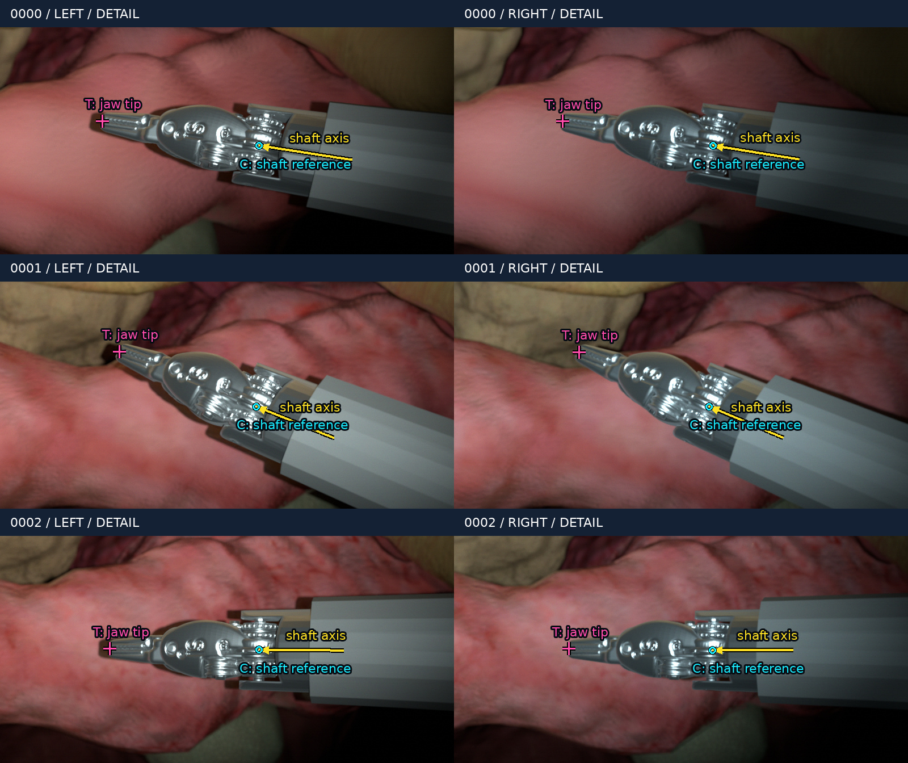

# SurgicalPoseEstimation

Per-camera ground truth and projected overlays for the current single-instrument scene. No trained model is included yet.

## Output contract

Each image pair contains these three vectors for **each** camera:

| Symbol | JSON field | Meaning | Unit |
|---|---|---|---|
| C | `shaft_reference_position_mm` | Shaft/wrist joint center, origin of `psm_tool_roll_link` | mm |
| d | `shaft_direction_unit` | Normalized roll-link +Z, proximal to distal | unit vector |
| T | `tip_position_mm` | Midpoint of the two closed-jaw distal mesh-end centers | mm |

All three are required targets: **9 scalars per eye, 18 per stereo pair**. Optical axes are X right, Y down, Z forward. C and T are positions; d is a direction. This axis-and-tip representation does not independently specify shaft roll as a general full 6-DoF rotation would.

The tip uses actual mesh endpoints, not the nominal robot control-tip frame. For each jaw, average its unique maximum-local-Y vertices and apply its mesh transform; T is the midpoint of the two resulting centers. See the [machine-readable landmark definitions](examples/shaft_tip_stereo/config/landmark_definitions.json).

For the overlay, sample `C + s*d` from s = -9 to 0 mm in 0.1 mm steps and project with that camera's K and Brown–Conrady D. Cyan marks C, yellow marks the shaft axis and magenta marks T. Each camera's own labels and calibration suffice for this projection; an estimated left-to-right transform is not required.

## Included examples

`examples/shaft_tip_stereo/` contains six original 1920 × 1080 RGB PNGs, three JSON label records, applied configuration, checks and two annotated comparison sheets. The image SHA-256 is stored inside each corresponding label record. These are simulation ground truth, not predicted poses.

| Sample | Whole-instrument translation in left optical axes (mm) | Rotation about left optical Z |
|---|---|---|
| 0000 | (0, 0, 0) | 0 degrees |
| 0001 | (-12, -4, 0) | +15 degrees |
| 0002 | (-6, +5, +3) | -12 degrees |

Cameras and organs remain fixed. The jaw is closed and the existing straight-wrist configuration is retained. These are rigid-placement examples, not joint-limit/RCM-validated motion trajectories or a video frame-rate measurement.

[Checks](examples/shaft_tip_stereo/checks.json) compare prepared transforms and independently recompute distorted projections with OpenCV. The maximum recorded projection discrepancy is below 1e-12 pixels. This checks coordinate/projection consistency, not real-world accuracy. Some source-run paths in the preserved records refer to the original Ubuntu capture and caches rather than files in this reduced Git snapshot.
