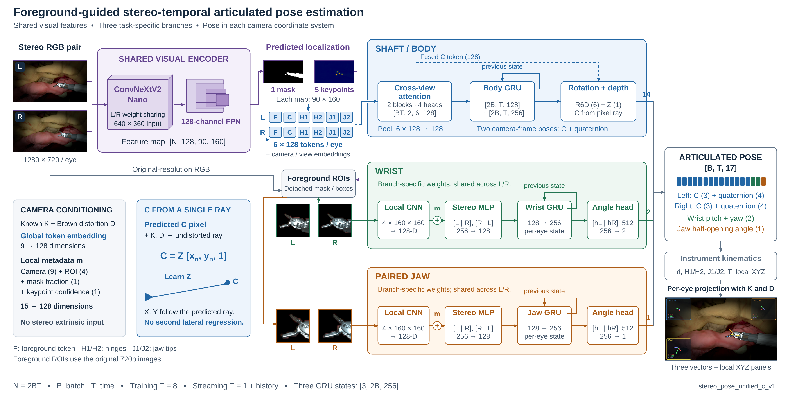
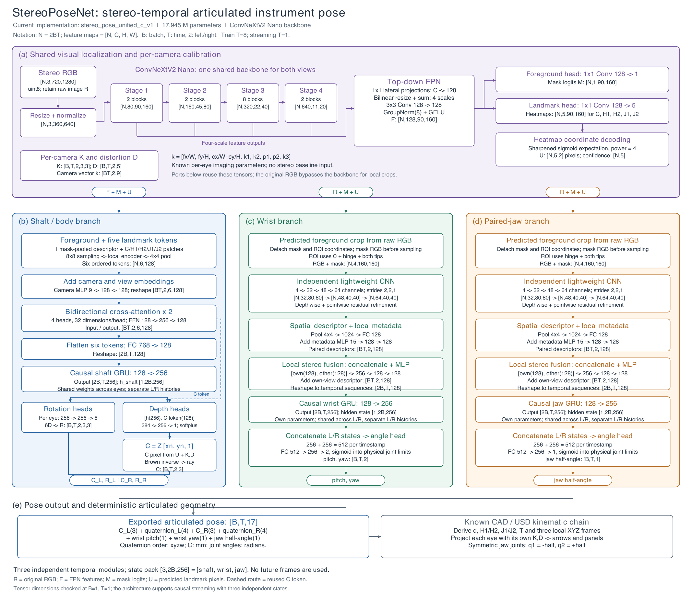
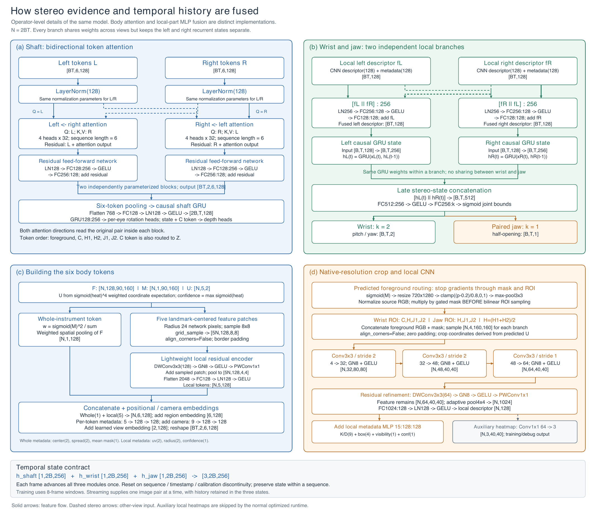

# 项目实现路线

## 1. 场景和成像

使用 Isaac Sim、ORBIT-Surgical 的单个 PSM 器械、关节化 ECM 与 SuFIA-BC 组织场景。双目相机随 ECM 运动；同一序列内相对关系固定，不同序列可以采用不同配置。采用来源明确的 K/D 和记录的成像调整值，区分标定数据与仿真采样设计。每目 1280×720，保持路径追踪、暗角最低线性增益 3.5% 和整体亮度系数 0.75。

## 2. 连续数据和标签

先规划连续路径，再按 60 Hz 保存同步双目图像、掩码、运动状态及几何真值。接触表示保形组织的表面接触／滑动，不代表组织变形或接触力仿真。关节限位、速度、真实网格碰撞及帧间路径检查独立于渲染。遮挡、固定尖端可见性、尖端区域可见性及过曝分别记录。

归档库存为 2,520 对／23 条轨迹；按完整轨迹归属统计为训练 1,820 对、验证 350 对、测试 350 对。公开协议见[数据划分](DATA_PROTOCOL.md)。资产、图像和权重属于外部输入；本目录不声称包含可直接重放历史精度的完整实验包。

## 3. 模型路线

从共享视觉编码、双目特征融合和因果时序基线，逐步形成预测前景引导、独立腕部／钳口原图分支，以及唯一的 C 像素射线与深度路径。主干预训练初始化后与任务分支联合优化。详细过程见[架构探索](../StereoPoseLearning/docs/ARCHITECTURE_EXPLORATION.md)。

模型输出每目 C 与杆体四元数，加两目共享的腕俯仰、偏航及半开合角，共 17 值。固定几何解码为杆轴方向、实际铰链、实际尖端、中点和部件自身坐标轴。模型输入不需要双目间外参；左右输出分别通过各自 K/D 投影。

## 4. 三张结构图

[逐模块尺寸、输入输出及融合说明](../StereoPoseLearning/docs/MODEL_DIAGRAMS.md)。图中示例展示接口，不作为独立测试结论。

## 5. 显示与部署

显示模块使用 C→C+15d、H1→J1、H2→J2 三组箭头，配各部件随器械旋转的 XYZ 轴、数值和透明面板。推理保持杆体、腕部、钳口三个因果状态；序列切换或异常后重置。

执行优化包括 C++ LibTorch、GPU 预处理、TensorRT 视觉前端、C 点 CUDA 计算、固定缓冲区与 CUDA Graph、并行 C++ 绘图以及预处理／局部裁剪融合。没有用降低输入尺寸或重新训练来解释这组执行速度对照。关键点归约候选没有稳定完整流程收益，默认关闭。

| 历史执行阶段 | 双目完整处理耗时 | 平均速率 |
|---|---:|---:|
| TensorRT 视觉前端 | 约 26.5 ms | 约 37.8 Hz |
| Graph、缓存、绘图及 level5 引擎 | 约 15.23 ms | 约 65.7 Hz |
| 预处理与局部裁剪 CUDA 融合 | 约 12.98 ms | 约 77.0 Hz |

口径为内存 RGB 到投影绘图完成，不含采集、解码、编码与屏幕刷新。不同轮次的基线存在小幅波动；最终融合的同轮基线是 15.277 ms。性能、资源、被拒绝候选和数值回归记录见[性能索引](../StereoPoseLearning/docs/PERFORMANCE_INDEX.md)。

## 6. 数据统计与验证边界

源码测试检查数学、接口、因果性、前景路由、数据划分和恢复机制。它们不证明真实图像上的预测准确率。新的模型精度结果需要按公开协议训练、选择验证最优权重，再在未参与训练与选择的测试轨迹上评价。历史性能测量也不替代实机视觉精度或闭环机器人控制验证。
